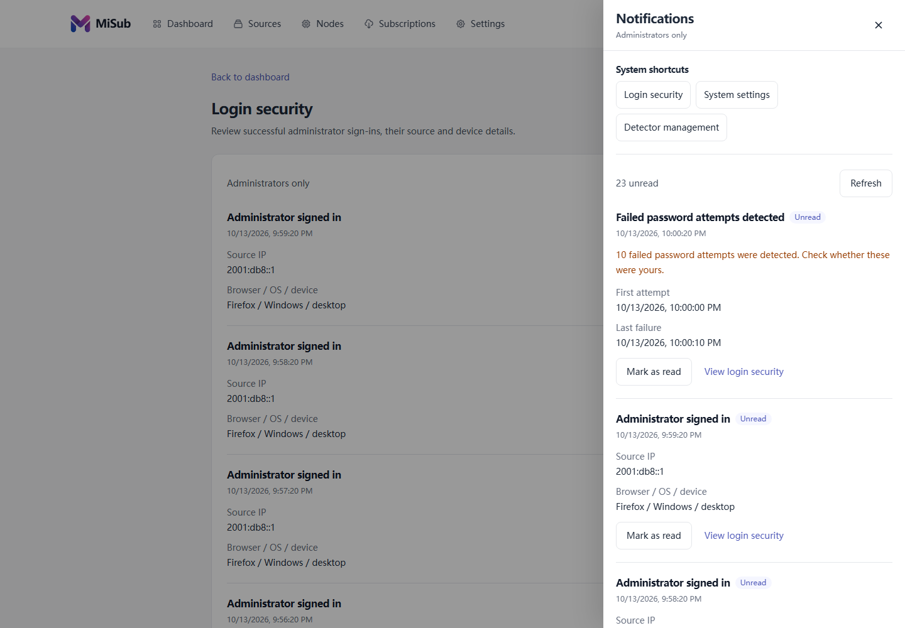
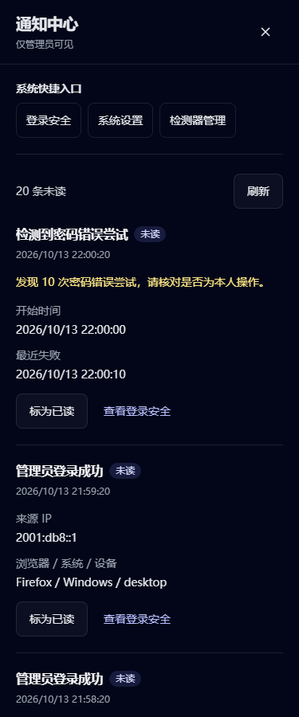
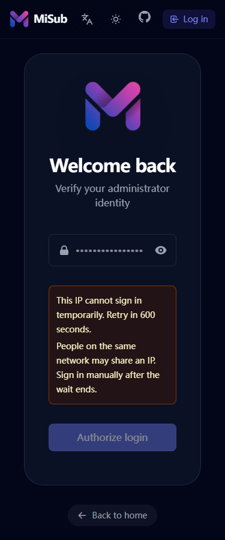

# 管理员通知中心

通知中心使用 [Issue #32](https://github.com/58cdn/MiSub/issues/32) 和 [后端 PR #38 冻结接口契约 v1](https://github.com/58cdn/MiSub/blob/8b9d52cafc3d7a6c8358d7476476716d1a11ffbc/docs/login-security-contract.md)。管理员可从新旧布局的导航铃铛查看系统消息、确认本页已读，或进入登录安全、系统设置和检测器管理。

## 交互与权限

- 每页 20 条，按服务端整数 ID 游标切换前后页；刷新回到最新页。未读数来自服务端，覆盖当前保留期内的全部通知。
- 打开面板、浏览消息和跳转均不更改已读状态。单条或“将本页标为已读”只向 `POST /api/admin/notifications/read` 提交本页指定 ID，成功后重新读取服务端状态。
- 已读操作失败时保留未读状态；若 POST 已成功但随后刷新失败，保留已确认的结果并提示重试。接口返回 `enabled:false` 时清除显示中的安全数据并明确提示未启用。
- 注销、过期会话和重新认证会清理通知状态；旧异步请求不能恢复上一会话的数据。通知只保存在当前内存中。
- 401/403 显示无权限提示并清除列表；旧服务端 404/501 显示接口尚不可用；网络、格式与存储错误显示可重试的错误态。无消息与未启用状态分别展示。
- `/dashboard/security` 展示只读的成功登录审计分页。消息的 `target` 通过前端固定枚举映射站内路由，所有事件字段使用文本插值。
- 登录 429 的倒计时优先使用服务端 `retryAfter` 秒数，避免本机时间偏差。倒计时只控制提示和重复提交，服务端决定是否允许登录；不会自动再次发送密码。
- 成功登录后的 `loginSecurity.warning` 与现有默认密码提示独立显示；确认对应消息已读后隐藏本次登录的提醒。

## 界面约定

沿用现有 Inter / 系统字体、紫色主题与圆角变量。基础色为页面浅灰 `#f7f8f8`、白色 `#ffffff`、深色 `#08090a`、正文 `#111827` 和主题紫 `#7170ff`；警告使用项目已有 amber 语义色。正文左对齐，通知按时间纵向排列并以分隔线区分，未读除颜色外还显示文字。

```text
导航铃铛 + 未读数
                     通知中心        关闭
                     固定系统快捷入口
                     未读总数        刷新
                     消息标题 + 已读状态
                     时间 / 来源 / 设备
                     标为已读 · 查看登录安全
                     本页已读确认
                     上一页 · 页码 · 下一页
```

桌面右侧面板最大 480px，手机使用屏幕宽度；原生模态对话框隔离背景操作并锁定滚动，显式处理 Tab 循环、Escape 和关闭后的焦点返回。动作触控高度至少 44px，通知按钮沿用导航触屏规则。旧版导航允许换行，iOS 内容偏移使用实测导航高度。

## 本地验证

```sh
npm ci
npm run test:run
npm run build
node tests/browser/admin-notifications.mjs
```

浏览器脚本使用隔离 Chromium 配置和本地生产构建；API 全部由合成数据实现，第三方字体请求被拦截。可用 `PLAYWRIGHT_CHROMIUM_EXECUTABLE_PATH` 指定已有 Chromium，输出目录默认为 `tmp/notification-evidence`，也可通过第一个参数指定。报告包含布局、接口调用边界和交互结果，截图覆盖桌面/手机、中文深色/英文浅色、空态、错误态、禁用态与权限态。

单元测试覆盖游标、幂等 ID 请求、未读确认、禁用切换、失败重试、失效会话、迟到响应、枚举跳转、文本转义和登录锁定。浏览器验证包含完整前端登录响应链、分页已读、键盘焦点与新旧布局跳转。

失败次数锁定、D1 事务、可信来源 IP、数据保留清理及会话授权由后端 PR 提供。[前后端本地联调](login-security-integration.md)使用真实后端处理器和内存 SQLite 验证登录、警告、分页、已读及兼容行为；本地 D1 模拟器另行验证并发和事务。生产安全存储启用与生产验收须按 Issue #32 的授权边界执行。

## 合成数据界面截图

以下截图来自本地 Chromium，使用示例 IP、固定事件和隔离浏览器配置。Safari 专属样式经过代码复核，尚未在真机 Safari 验收。






