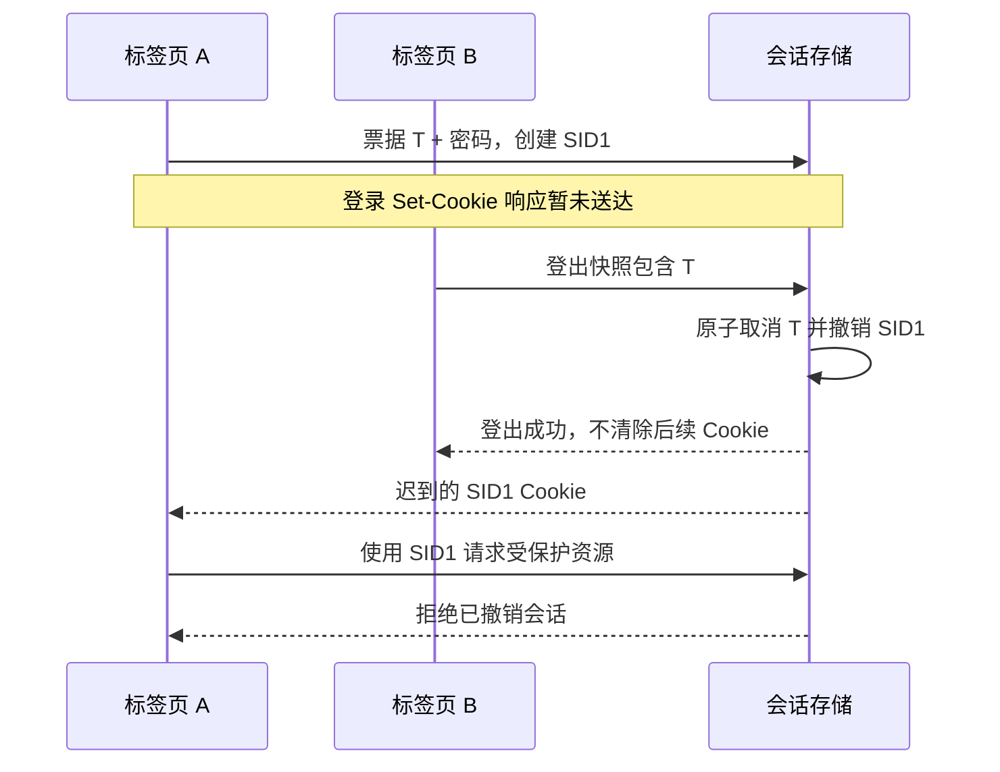

# 会话撤销与 Cookie 响应乱序：离线协议提案

状态：2026-10-14，供 PR #40 架构决策与离线审查。`experiments/session-cookie-protocol/` 使用内存 SQLite 和可预测的合成凭据，未接入 MiSub 的登录、续期、登出或鉴权路由。现有产品的 Cookie 复活问题仍是上线阻塞项。

## 问题与保证范围

现有 `functions/modules/auth-middleware.js` 使用带时间戳的签名 Cookie；登录和普通请求的续期响应写同名 `auth_session`，登出仅清除浏览器 Cookie。服务端缺少可撤销会话记录。已经发出的登录或续期响应若晚于登出送达，会再次写入仍可通过鉴权的凭据；反向顺序中，旧登出响应可能清掉新登录的 Cookie。前端请求代次和回调过滤不能控制浏览器处理 `Set-Cookie`。

RFC 6265 说明同名、同域、同路径 Cookie 会被替换，并明确并发 `Set-Cookie` 的响应竞争。此提案据此区分两个问题：服务端撤销旧凭据的授权，以及避免旧响应覆盖新凭据的 Cookie 存储。参见 [RFC 6265，4.1.1、4.1.2 和 5.3](https://www.rfc-editor.org/rfc/rfc6265)。

目标保证是：一次登出事务成功提交后，后续鉴权拒绝该动作固定捕获的旧会话及待完成登录；随后独立发起的新登录仍可使用。已经完成鉴权的业务请求是否继续提交，属于业务事务边界，本提案不能撤回已准入的操作。

## 候选协议

1. 浏览器先在同源 IndexedDB 事务中登记登录意图，再请求一次性登录票据。票据有独立取消能力，只能取消对应操作及其生成的会话，不能用于登录。登录意图只允许绑定一个票据；相同绑定可重试，另一票据不能覆盖它。
2. 登录提交密码、票据、取消证明，以及动作开始时捕获的旧 SID 和待完成票据。服务端在一个事务内验证全部证明、撤销这些旧目标、取消这些旧操作，再签发全新 SID 和随机凭据。生产发行器必须用密码学安全随机数；实验中的顺序 ID 和字符串仅供 fixtures 使用。
3. 每个 SID 使用唯一 Cookie 名称，例如 `__Host-misub_sid_<sid>`，带 `Secure; HttpOnly; SameSite=Strict; Path=/`。SID 永不重用，Cookie 中包含独立的 bearer secret。服务端仅保存 secret 摘要、到期时间和撤销状态。新登录必须轮换凭据，不能将匿名范围标识升级为登录凭据；参见 [OWASP Session Management](https://cheatsheetseries.owasp.org/cheatsheets/Session_Management_Cheat_Sheet.html)。
4. 浏览器收到登录结果后另行确认对应 Cookie 已能通过鉴权，再将公开 SID 记录为已确认。跨标签页共用 IndexedDB，保留 SID 与公开票据 ID 的关联，后续登录可以清理已被替换的旧记录。JS 不读取或保存会话 bearer secret。
5. 登出先持久化固定目标快照：当时已确认的 SID，以及仍在途的票据和取消证明。服务器验证全部目标后原子撤销。显式指定的活动 SID 缺少对应 Cookie 或票据证明时返回 403，不能确认成功或只撤销其中一部分。
6. 登出响应不写通用清除 Cookie。重试使用同一快照，忽略 HTTP 自动附带但不在快照内的新会话；因此旧登出不能撤销之后的新登录。续期只延长同一 SID 和同一凭据，不创建新的授权代次。
7. 丢失的登录响应重试仅返回已提交状态与公开 SID，不重建 secret、不重新签发 Cookie。若没有收到 Cookie，需要用户再次明确提交密码创建新登录。网络错误或 503 不等于登出成功；快照保留供重试。



## 存储、事务与可用性

所需逻辑表是 `sessions(sid, secret_hash, expires, revoked)` 与 `login_operations(id, cancel_hash, redeem_deadline, state, sid)`。取消票据的授权期与登录兑换期不同：已提交票据的映射必须保留到其会话不再可能授权，包含未确认和未送达响应的情况。撤销/过期记录可回收，但未知 SID 和未知票据必须始终拒绝，不能按来路重建。生产还需要绝对会话期限、操作保留期、索引和清理预算。

每次鉴权都依赖最新的服务端状态。会话库不可用时返回 503，不回退到旧签名 Cookie，也不缓存“仍有效”的结论。D1 文档描述 `batch()` 的事务回滚语义；未使用 Sessions API 的查询访问主实例。若使用 `withSession('first-primary')`，只有该会话的首次查询明确访问主实例，不能将其误认为此后每次读取都访问主实例。生产适配器必须证明每个鉴权请求的最新读取，以及条件校验、旧状态撤销和新会话创建的同一事务边界。当前 Node SQLite 的同步 `BEGIN IMMEDIATE` **不是 D1 适配器验收**。参见 [D1 Database API](https://developers.cloudflare.com/d1/worker-api/d1-database/)。

Workers KV 的最终一致性不适用于本提案的即时撤销保证。参见 [Workers KV 一致性说明](https://developers.cloudflare.com/kv/concepts/how-kv-works/)。

| 待选存储方案        | 影响                                                                                                                     |
| ------------------- | ------------------------------------------------------------------------------------------------------------------------ |
| 专用会话 D1（建议） | 需新增明确授权的 binding、迁移和运维；鉴权不与订阅数据或通知审计表共享故障域。每次鉴权增加数据库读取，需评估延迟和费用。 |
| 明确复用安全 D1     | 减少一个数据库资源，但必须先核实该 binding 的部署状态，并接受登录、审计/通知共用可用性和写入预算；仍需新增表与权限审查。 |

未创建数据库、密钥、身份、binding 或迁移执行任务，也未更改工作流。产品接入和生产资源操作分别审批。

## 浏览器状态、容量与尚未完成的边界

实验的正常鉴权最多解析 8 个候选 Cookie、4 KiB；维护路径单独限制为 32 个候选、16 KiB，只返回服务端已失效的 SID。固定 SID 清理接口不经过正常鉴权的数量限制，并再次确认 SID 不活跃才发送对应删除 Cookie。正常登录前后执行维护；迟到的清理只能删除永不重用的旧名称。超维护上限时仍拒绝；如果客户端持有旧 SID 元数据，可以逐个清理，未知 Cookie 的超限恢复 UI 与平台入口头部上限尚未验收，不能承诺任意数量可自动恢复。

IndexedDB 最多准入 16 个已绑定的待完成登录，超额先处理已有操作。已取消但尚未绑定的意图可以回收；晚到的绑定必须失败。登出快照及确认都使用 IndexedDB 读写事务，不能用单标签页内存队列代替。

以下是接入生产前必须实现和验证的工作，不属于当前实验已经完成的保证：

- **本地协调数据丢失。** 若 IndexedDB 被清空而 Cookie 仍有效，新 registry 的空快照不能代表已登出。生产需要受保护的当前 SID 元数据恢复、带代次的跨标签页同步和操作准入；无法找回在途票据取消能力时必须显示未确认状态或要求撤销更大范围。当前实验未实现恢复，空快照可能确认成功而仍保留旧权限，因此不可直接用于产品。
- **持久化失败和崩溃。** IndexedDB 不可用时停止登录/登出准入；崩溃恢复需要明确如何处理保存的未完成快照、不同网页版本、被淘汰的 Cookie，以及丢失尚未绑定的票据响应。
- **接口与资源保护。** 实际路由的 Origin/CSRF、缓存禁止、请求体/票据长度、匿名票据发行限流、密码尝试限流、重复操作配额、清理预算、随机数、常量时间比较及日志脱敏需要复用并检验现有安全机制。实验路由只存在于 Playwright 拦截器，未替代这些检查。
- **迁移和回滚。** 建议版本切换时一次性拒绝旧 `auth_session` 并要求重新登录。自动接受旧 Cookie 会重新引入无法撤销的授权。若发布回滚到旧鉴权实现，保证也随之失效，需明确回滚策略和用户提示。
- **登出范围。** 当前设计针对同一浏览器存储中的已知会话和在途登录。跨设备/全管理员会话撤销需要用户级 epoch 或额外索引、独立明确操作及测试，不能暗中扩大普通登出的范围。
- **真实运行环境。** Cloudflare D1 并发和主实例读取、多个 Worker 实例、Safari/WebKit、代理/CDN 响应处理与移动端存储回收均未实测。

## 离线复现与验收

运行需要 Node.js 22.13+（内置 `node:sqlite`），仓库依赖和本机已有的 Playwright Chromium。测试全部使用合成凭据；浏览器只访问拦截的 `https://session-protocol-fixture.invalid`，外部请求中止，无监听公网端口。

```sh
node node_modules/vitest/vitest.mjs run tests/unit/session-cookie-protocol-model.test.js
node tests/browser/session-cookie-protocol.mjs /absolute/path/to/evidence
```

可用 `MISUB_BROWSER_EXECUTABLE` 指定已有的 Chromium。浏览器报告记录 UTC 时间、Git HEAD、模型与 registry 的 SHA-256、检查结果、状态码、浏览器版本及拦截越界请求，不记录 Cookie 值或取消证明。

当前验证分为 SQLite 模型的响应排列与事务测试，以及真实 Chromium Cookie/IndexedDB 上运行的候选协议测试。它们不使用产品 auth handler；已有产品 Cookie 乱序复现与候选方案通过是两组不同证据。最终执行计数和独立复验记录在 PR #40。

产品接入前需要确认：会话存储选择、旧会话强制重新登录与回滚策略、普通登出范围及协调数据丢失后的恢复语义。确认前可以继续适配器设计和离线测试，不能以本实验通过替代产品修复、Cloudflare 部署或实网验收。
